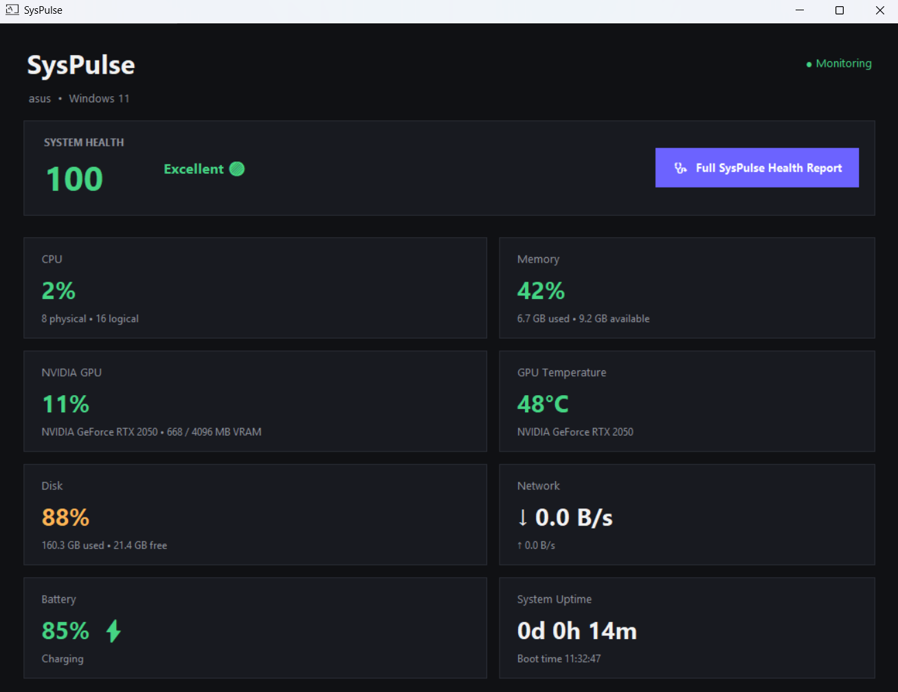
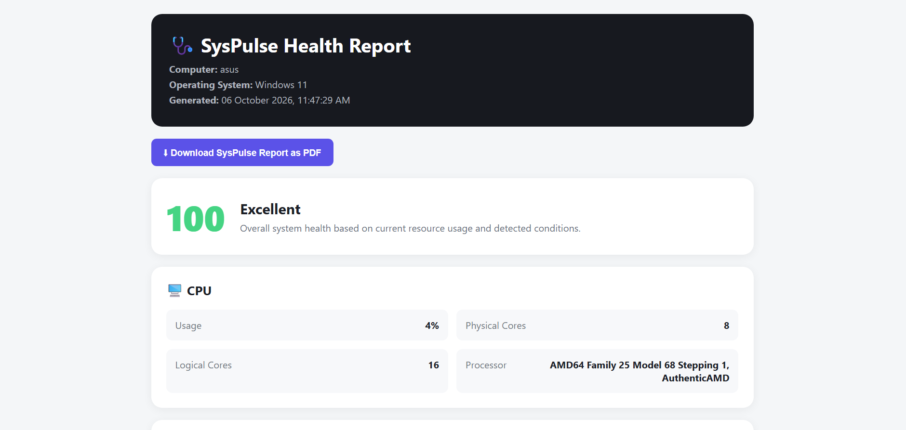

# SysPulse 🩺

SysPulse is a system-monitoring project with a lightweight Windows desktop dashboard and an Android app.

The Windows dashboard provides a live overview of system health, resource usage, GPU information, battery status, network activity, storage, uptime, top processes, and a generated HTML health report.

## ✨ Windows Features

- 🖥️ Live CPU usage and processor information
- 🧠 RAM usage, used memory, total memory, and available memory
- 🎮 NVIDIA GPU usage, temperature, and VRAM information
- 💾 C: drive storage usage
- 🌐 Download and upload network activity
- 🔋 Battery level and charging status
- ⏱️ System uptime and boot time
- ⚠️ Automatic system health score and alerts
- 🔥 Top CPU-consuming processes
- 🩺 Full HTML health report with recommendations
- 📄 Browser-based report printing / PDF export
- 🌑 Dark desktop dashboard
- 🪟 Standalone Windows executable

## 📥 Downloads

Get the latest builds from **[GitHub Releases](https://github.com/Athuldas2006/SysPulse/releases/latest)**.

| Platform | Download | Installation |
| --- | --- | --- |
| Windows | Download `SysPulse.exe` from the latest release | Download and run the executable. Python is not required. |
| Android | Download the SysPulse APK from the latest release | Download the APK on your device, open it, and follow Android's installation prompts. If prompted, allow your browser or file manager to install apps from that source. |

Only install APK files you downloaded from the official SysPulse repository. Check the release notes for version-specific requirements and changes.

## 📸 Windows Screenshots

### Main Dashboard

### Health Report

## 🚀 Run the Windows Executable

For Windows users who just want to use SysPulse:

1. Open the [latest release](https://github.com/Athuldas2006/SysPulse/releases/latest).
2. Download **SysPulse.exe** from the release assets.
3. Run it.

No Python installation is required when using the executable.

## 🐍 Run the Windows App from Source

### Requirements

- Windows
- Python 3.10+
- `psutil`
- NVIDIA drivers + `nvidia-smi` for NVIDIA GPU telemetry

Tkinter is included with standard Windows Python installations.

### Installation

Clone the repository:

~~~powershell
git clone https://github.com/Athuldas2006/SysPulse.git
cd SysPulse
~~~

Install the dependency:

~~~powershell
python -m pip install -r requirements.txt
~~~

Run SysPulse:

~~~powershell
python src/SysPulse.py
~~~

## 📁 Project Structure

~~~text
SysPulse/
├── assets/
│   ├── icon.ico
│   ├── SysPulse.png
│   └── SysPulse1.png
├── src/
│   └── SysPulse.py
├── SysPulse.exe
├── .gitignore
├── LICENSE
├── README.md
└── requirements.txt
~~~

Android APKs are distributed through GitHub Releases rather than stored in the source tree.

## 🛠️ Built With

- Python
- Tkinter / ttk
- psutil
- NVIDIA SMI
- HTML / CSS for generated reports
- Android app build (see the Android source and build setup in the repository, if available)

## 🔒 Privacy

The Windows desktop version is designed as a local monitoring application. System information is collected locally for display and report generation; it does not require an online account or cloud backend.

Review the Android app's requested permissions and the release notes before installing it.

## 📌 Notes

- GPU telemetry depends on `nvidia-smi`. If NVIDIA GPU information is unavailable, the rest of the Windows monitoring dashboard can still operate.
- The generated Windows health report is saved locally in a `Reports` folder next to the executable or source script.
- Android installation compatibility may depend on your device and Android version; check the release notes for the build you download.

## 📄 License

This project is released under the MIT License. See [LICENSE](LICENSE) for details.

## 🐛 Issues and Feedback

Found a bug or have a suggestion? [Open an issue](https://github.com/Athuldas2006/SysPulse/issues) and include your device/OS details, steps to reproduce the problem, and any relevant error messages. Do not post private information or sensitive system logs.
